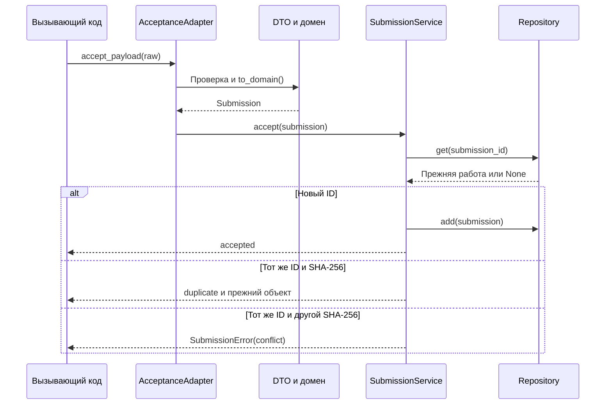

# Архитектура проекта

## Назначение и границы

Приложение принимает неизменяемые версии учебных работ и запускает анализаторы через
единый синхронный контракт. Исходный код хранится и анализируется как строка.
Репозиторий находится в памяти одного процесса. Результат анализа описывает наблюдения,
а не решение об авторстве, плагиате или оценке.

## Направление зависимостей

```text
interfaces → bootstrap → adapters / analyzers
                             ↓          ↓
                         application ←──┘
                             ↓
                           domain
```

| Пакет | Назначение | Допустимые зависимости |
|---|---|---|
| domain | Модели, инварианты, ошибки и SHA-256 | Стандартная библиотека и домен |
| application | Сценарии приёма/анализа, порты, реестр, проверка отчёта | Домен и application |
| adapters | Pydantic DTO, источники, импорт и репозиторий | Домен и application |
| analyzers | Конкретные алгоритмы и расширения | Домен и application |
| interfaces | CLI, аргументы, JSON и коды завершения | Сборка приложения и внешние адаптеры |
| examples | Сквозная демонстрация и измерение | Собранное приложение и его адаптеры |

Сервисы не импортируют Pydantic, HTTP, файловые источники или классы анализаторов.
Конкретные зависимости создаёт bootstrap. Каждый экземпляр приложения получает собственные
репозиторий и реестр. Общий изменяемый контейнер на уровне модуля не используется.
Статическая проверка 27 модулей не выявила циклических импортов и нарушений слоёв;
результат сохранён в docs/evidence/architecture.json.

## Приём данных

1. Источник возвращает SourceRecord с физическим номером строки и объектом либо ошибкой JSON.
2. AcceptanceAdapter проверяет внешнюю схему через Pydantic и создаёт доменную Submission.
3. SubmissionService вычисляет отпечаток и сверяет существующий идентификатор.
4. Репозиторий добавляет новую версию или сохраняет прежнюю при повторе/конфликте.

DTO и домен используют общие чистые проверки. DTO запрещает неявные преобразования и лишние
поля, а __post_init__ защищает инварианты при прямом создании доменной модели.
Валидация не меняет вход. strip используется для проверки пустоты; оригинальные text,
code и строковое представление времени сохраняются.

Submission и вложенная декларация — frozen dataclass; коллекции доменных объектов — tuple.
Новый submission_id обозначает новую версию. Тот же ID и хеш возвращают duplicate с ранее
сохранённым объектом. Другой хеш при прежнем ID даёт conflict без перезаписи.

SHA-256 вычисляется от всей сдачи, включая ID и декларацию, по согласованной сериализации
UTF-8 JSON. Порядок ключей не влияет на хеш; пробелы и переводы строк исходника влияют.
Это отпечаток версии, а не доказательство авторства и не алгоритм частичного сходства.

## Ошибки и ресурсы

Публичная ошибка содержит code, field и message. Ошибки Pydantic переводятся в этот контракт
на границе; наружу не передаются исходные данные и внутренние URL библиотеки. При нескольких
нарушениях возвращается первый отказ в порядке валидации; поле вложенного отказа сохраняется.

Ошибки отдельной записи — повреждённый JSON, нарушение схемы или conflict — попадают
в ImportSummary с номером строки. Следующие записи продолжают обрабатываться. Невозможность
читать источник остаётся отдельным отказом ввода-вывода. Импорт не является транзакцией
всего файла: уже принятые записи не откатываются.

JsonlSource владеет файлом через контекстный менеджер и закрывает его при обычном выходе,
break и исключении. После контекста закрывается и генератор записей. Слишком длинная
физическая строка дочитывается ограниченными порциями, чтобы сохранить нумерацию и продолжить
импорт без хранения её целиком. Пределы JSON-парсера также становятся ошибкой записи.

InMemorySource копирует входные объекты и выдаёт независимые копии при открытии.
StreamSource работает с чужим потоком: не закрывает его и начинает с текущей позиции.
Политика владения потоком отличается от файлового источника и не скрывается общим интерфейсом.

Строки должны кодироваться в UTF-8 до хеширования. Обычный Unicode и emoji сохраняются,
суррогаты отклоняются. Некорректный ключ в диагностике представляется экранированно, чтобы
не повредить JSON-вывод, но содержимое самой сдачи не нормализуется автоматически.

## Анализ и расширения

Analyzer, SubmissionRepository и SubmissionSource определены в application/ports.py через
Protocol. Это структурные контракты: реализация не обязана наследоваться от протокола.
Аннотации помогают статической проверке, а поведение подтверждается контрактными тестами.

AnalyzerRegistry хранит фабрики. AnalysisService выбирает анализатор по имени и не ветвится
по конкретным классам. Регистрация DeclarationAnalyzer или MissingExplanationAnalyzer
не требует изменения сервиса. Зависимость от простого реестра внутри application достаточна
для масштаба ЛР 1; отдельный контейнер зависимостей не требуется.

Отказы фабрики, чтения properties интерфейса и вызова плагина переводятся в AnalysisFailure
с сохранением исходной причины. Ожидаемый AnalysisFailure передаётся без замены.
Затем validate_report проверяет структуру, связь со сдачей/конфигурацией, метаданные,
объяснения, score и границы evidence. Сервис дополнительно сверяет результат с вызванным
анализатором. Проверка результата не создаёт изоляцию кода плагина от процесса.

LengthAnalyzer считает непустые исходные строки text/code и не оценивает корректность.
TemplateAnalyzer ищет точные непрерывные блоки разрешённого шаблона без нормализации пробелов.
Оба возвращают score=null. Evidence использует исходную нумерацию от 1 включительно.

DeclarationAnalyzer работает с уже проверенной декларацией: непустые tool/purpose при
used=true гарантированы доменом. Он описывает заявление и выставляет review_required,
если студент не подтвердил проверку результата. Декларация не устанавливает авторство.

config_hash включает задание и config_version. Изменение шаблона или версии меняет хеш.
UUID и время характеризуют конкретный запуск; повторяемость проверяется по наблюдениям
и хешам. make_report принимает часы и фабрику ID для детерминированных unit-проверок.

## Сборка и интерфейс

build_application проверяет конфигурацию до пользовательского вызова. Неизвестное имя,
повтор, пустой список, неверная версия и неподдерживаемые параметры отклоняются при старте.
Фабрики обязательных реализаций выбираются в bootstrap, а не в сервисе приёма.

CLI отвечает за аргументы, stdout/stderr и код завершения. Установленный пакет запускается
через school-lab или python -m school_lab. Импорт модулей не запускает обработку данных.
Каждый отдельный запуск import создаёт новое in-memory состояние; повторный приём в одном
процессе демонстрирует команда demo.

HTTP, ORM, конкурентный приём и постоянное хранение выходят за объём ЛР 1. Для конкурентной
версии потребуются атомарность get/add и постоянное уникальное ограничение идентификатора.

## Жизненный цикл компонентов

| Объект | Когда создаётся | Время жизни и владение |
|---|---|---|
| `Application` | Вызов `build_application` | Определяет состояние одного приложения |
| Репозиторий | При сборке приложения | Общий для сервисов приёма и анализа этого экземпляра |
| Реестр | При сборке приложения | Хранит фабрики; допускает явное добавление расширения |
| Экземпляр анализатора | Каждый вызов `registry.create` | Создаётся для текущего анализа, не кэшируется реестром |
| `Submission` | Успешное преобразование DTO | Сохраняется репозиторием; дубликат возвращает прежний объект |
| `AnalysisContext` | `app.context(assignment)` | Неизменяемый снимок задания и версии конфигурации |
| Файловый handle | Вход в `JsonlSource.open()` | Принадлежит источнику до выхода из `with` |
| Итератор записей | Вход в контекст источника | Закрывается при выходе, даже если потребитель не дочитал |

Проверка встроенной фабрики при сборке создаёт пробный экземпляр; последующий анализ
создаёт новый. Поэтому фабрика не должна рассчитывать на единственный вызов или на
состояние ранее созданного экземпляра. Сам реестр не хранит результаты анализа.

Файл задания не является частью репозитория работ. Приём сохраняет заявленный
`assignment_id`, а сервис анализа сверяет его с переданным контекстом. Такой порядок
позволяет принимать корпус независимо от загрузки заданий и явно диагностировать ошибку
контекста при анализе. `requirements` участвуют в отпечатке конфигурации, но текущие
алгоритмы не проверяют каждое требование автоматически.

## Маршрут одной операции



Импортёр повторяет эту операцию для каждой записи. Сводка содержит исходы обработки,
а репозиторий — только принятые уникальные версии. Сервис анализа затем читает принятую
работу из того же репозитория, создаёт плагин через реестр и проверяет его результат.
Принятые объекты не заменяются отчётами и не дополняются вычисленными признаками.

## Обоснование решений

| Решение | Причина | Следствие |
|---|---|---|
| DTO отдельно от домена | Внешняя схема и правила версии имеют разные обязанности | Pydantic не распространяется на application/domain |
| Чистые общие валидаторы | DTO и прямой конструктор должны защищать одинаковые инварианты | Изменение правила производится в одном месте |
| `frozen`, `slots`, вложенные неизменяемые значения | Сохранённая версия не должна меняться обычным присваиванием | Отпечаток остаётся связан с исходным содержимым |
| `Protocol` для портов | Нужен небольшой поведенческий интерфейс без базовой реализации | Адаптер заменяется структурно совместимым объектом |
| Явная композиция | Источники, хранение и алгоритмы меняются независимо | Замена компонента не требует новой иерархии сервисов |
| Реестр фабрик | Выбор алгоритма не должен ветвить центральный сервис | Расширение добавляется регистрацией |
| Контекстный менеджер источника | Генератор после `break` может оставаться открытым | Владение ресурсом имеет явную границу |
| Проверка отчёта после плагина | Аннотации не гарантируют результат во время выполнения | Несовместимый отчёт отклоняется на границе приложения |
| `src`-структура | Импорт из корня может скрыть дефект упаковки | Установка и запуск wheel проверяются отдельно |

Глубокая копия используется на изменяемом внешнем входе `InMemorySource`. Внутри домена
копирование коллекций заменено неизменяемыми значениями: список требований превращается
в `tuple`, отчёты содержат кортежи наблюдений и свидетельств. Замороженный DTO со списком
сам по себе не гарантирует неизменность элементов списка; преобразование в домен устраняет
эту зависимость от входной коллекции.

## Политика версий и отпечатков

У схемы, анализатора и конфигурации разные области изменений. Версия схемы определяет
допустимый вход; версия анализатора обозначает реализацию алгоритма; версия конфигурации
вместе с полным заданием определяет `config_hash`. Общий номер пакета относится к поставке.

`submission_hash` не включает путь файла или номер строки импорта. `config_hash` не включает
список остальных зарегистрированных анализаторов: отчёт отдельно хранит собственные
`analyzer_id` и `analyzer_version`. Поэтому регистрация дополнительной фабрики не меняет
отпечаток задания. Семантически равные даты в разных строковых представлениях могут дать
разные хеши сдачи, поскольку принятый текст времени сохраняется без нормализации.

## Стоимость и границы замены

Хеширование линейно относительно размера сериализованной работы. Репозиторий использует
словарь: поиск по ID имеет ожидаемую постоянную стоимость, но сравнение версии повторно
вычисляет хеш прежнего объекта. Кэш отпечатков для масштаба корпуса не требуется.

LengthAnalyzer проходит строки исходника. TemplateAnalyzer сравнивает каждый возможный
блок с шаблоном; число сравнений растёт с числом исходных строк и длиной шаблона.
Потоковый JSONL ограничивает буфер чтения одной записи, однако репозиторий и сводка импорта
накапливаются в памяти. Ограничение чтения не означает постоянное потребление памяти
всей операцией.

Постоянное хранилище можно подключить реализацией порта репозитория, но конкурентный
приём потребует изменения операции: отдельные `get` и `add` не обеспечивают атомарность.
HTTP-адаптер сможет вызывать существующий приём, переводя `ApplicationError` в ответ своего
протокола. Изоляция недоверенных плагинов потребует отдельной границы процесса.
Точные схемы и публичные исходы собраны в [CONTRACTS.md](CONTRACTS.md).
